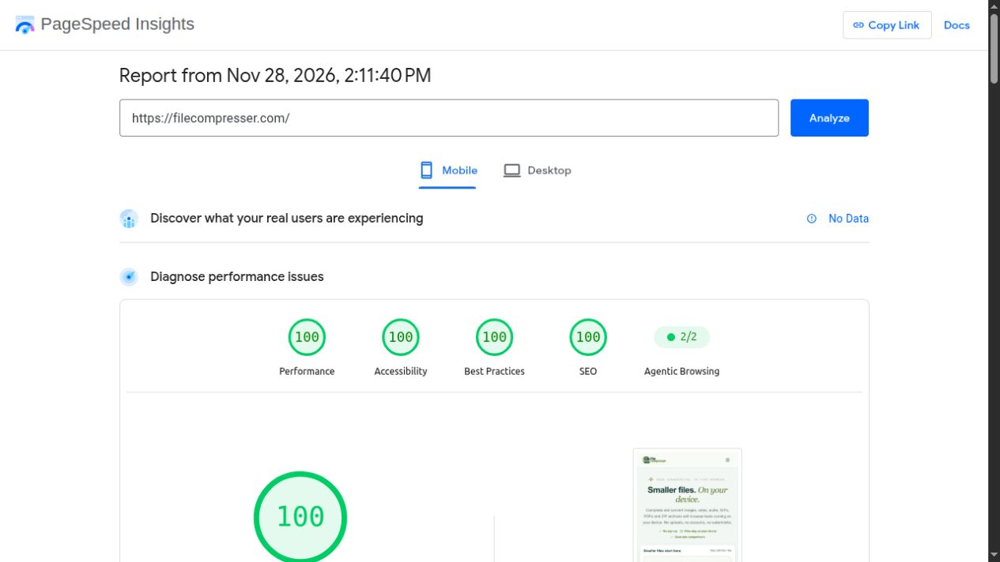
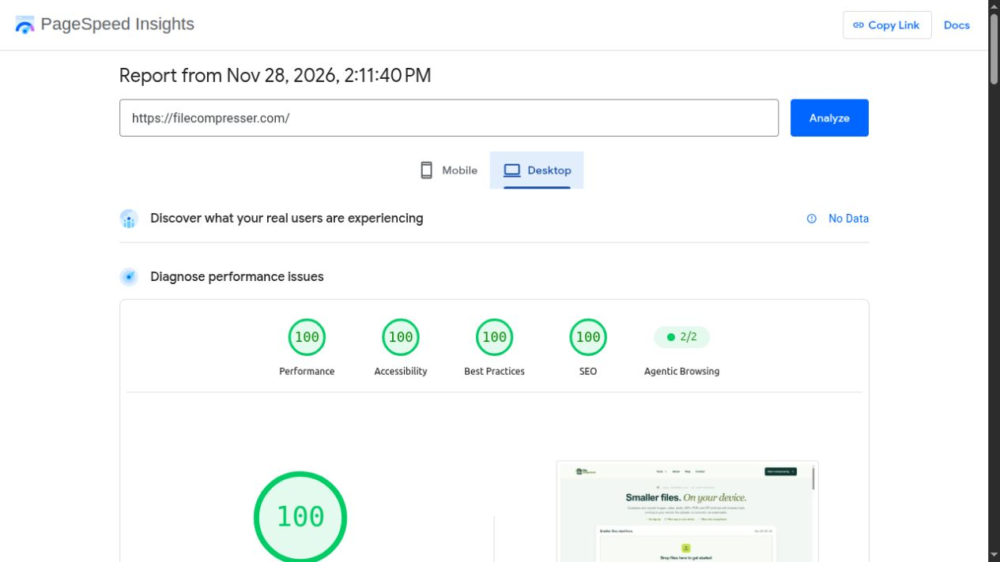

# Public homepage PageSpeed baseline

28 November 2026 (Asia/Karachi). This is the **pre-change public homepage baseline**, not a Phase 3 release result. One ordinary Analyze action was completed in the official PageSpeed UI at 14:11:40 GMT+5. Its mobile and desktop views were read from the same report; no score rerun, quota workaround or security bypass was used.

| Device | Performance | Accessibility | Best Practices | SEO | FCP / LCP | TBT | CLS | Speed Index |
|---|---:|---:|---:|---:|---|---|---:|---|
| Mobile | 100 | 100 | 100 | 100 | 1.0 s / 1.0 s | 20 ms | 0 | 1.0 s |
| Desktop | 100 | 100 | 100 | 100 | 0.3 s / 0.3 s | 0 ms | 0 | 0.4 s |

[Official mobile report](https://pagespeed.web.dev/analysis/https-filecompresser-com/apocwkl7bpnbdhy5try79l?form_factor=mobile), [desktop view](https://pagespeed.web.dev/analysis/https-filecompresser-com/apocwkl7bpnbdhy5try79l?form_factor=desktop), [machine-readable evidence](evidence/2026-11-28/public-pagespeed-baseline.json).

The table uses displayed rounded metrics. The native calculator link preserves mobile FCP/LCP/SI 950 ms, TBT 17 ms, CLS 0; desktop FCP/LCP 279 ms, TBT 0 ms, CLS 0, SI 354 ms. These values came from the report's calculator URL, not an exported Lighthouse JSON file. The report uses Lighthouse 13.6.0 and HeadlessChromium 157.0.8103.38, with emulated Moto G Power/Slow 4G and emulated desktop/custom throttling.

Both real-user panels say **No Data**. These lab scores do not establish field Core Web Vitals, physical-device performance, every tool's speed, complete accessibility or site-wide security. The report still lists diagnostics: render blocking, cache lifetimes, image delivery, legacy/unused JavaScript, one mobile long task, and desktop unused CSS. The collapsed summary estimates are retained in the JSON; they are not diagnoses of a specific source module or measured savings after a fix.

## Release identity and screenshots

Ordinary public HTTPS GETs before and after the single analysis both returned release **4c0d1d6be06d264a944bb302167caa7e1beec7e3**, corresponding to native Cloudflare deployment **a6a05243-a716-4428-9c85-ae53135b47bc**. The observed homepage was 110,378 bytes with unchanged SHA-256 **c45d94bb8ded2332d1321a3a5fda4c6a467a6c49c47c7d7d6e9bfeddd1224340**. The release JSON hash was also unchanged. Those observations bracket 09:10:51–09:13:52 UTC; PageSpeed's own fetched HTML hash is not exposed in the native capture.

After a verified Phase 3 production release, one separately identified report may provide the comparison. A later result must retain its actual scores, diagnostics, release identity and field-data availability. A 100 baseline cannot be described as an improvement caused by changes that were not yet public.
